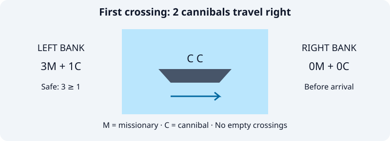
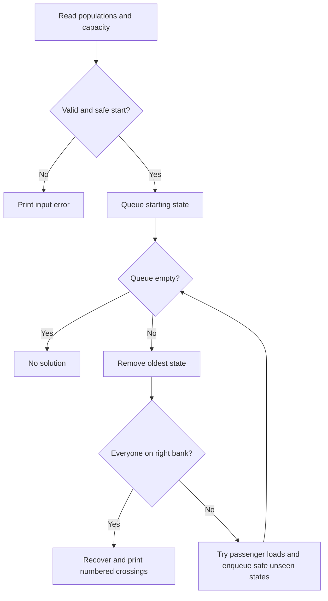

# Missionaries and Cannibals

**Aim:** Move everyone across a river without cannibals outnumbering missionaries on either bank containing missionaries. Either type can row; the boat cannot travel empty.

```sh
python3 missionaries_cannibals/main.py
```

Press Enter at each prompt for **3 missionaries, 3 cannibals, capacity 2**. Custom nonnegative populations and positive capacity are supported; at least one person is required.

```text
Step 0: Start | Left: 3M 3C | Right: 0M 0C | Boat: L
Step 1: 0M + 2C L -> R | Left: 3M 1C | Right: 0M 2C | Boat: R
...
Step 11: 0M + 2C L -> R | Left: 0M 0C | Right: 3M 3C | Boat: R
Total crossings: 11
```



## Algorithm

BFS explores states `(left missionaries, left cannibals, boat side)`. Try each available passenger combination, keep safe unseen states, and follow parent links to print the shortest route.



For either bank: $\operatorname{safe}(m,c)=(m=0)\lor(m\geq c)$.

For boat capacity $K$: $1\leq m_b+c_b\leq K$; passengers must be present on the departure bank.

**Performance:** With totals $M,C$, at most $2(M+1)(C+1)$ states. If $L$ is the number of possible loads, time is $O((M+1)(C+1)L)$ and space is $O((M+1)(C+1)+L)$; $L\leq(K+1)(K+2)/2-1$.

**Learning:** Constraint checking, reversible state transitions, and minimum-crossing search.
