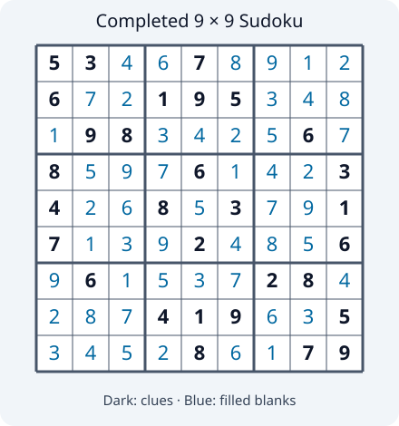
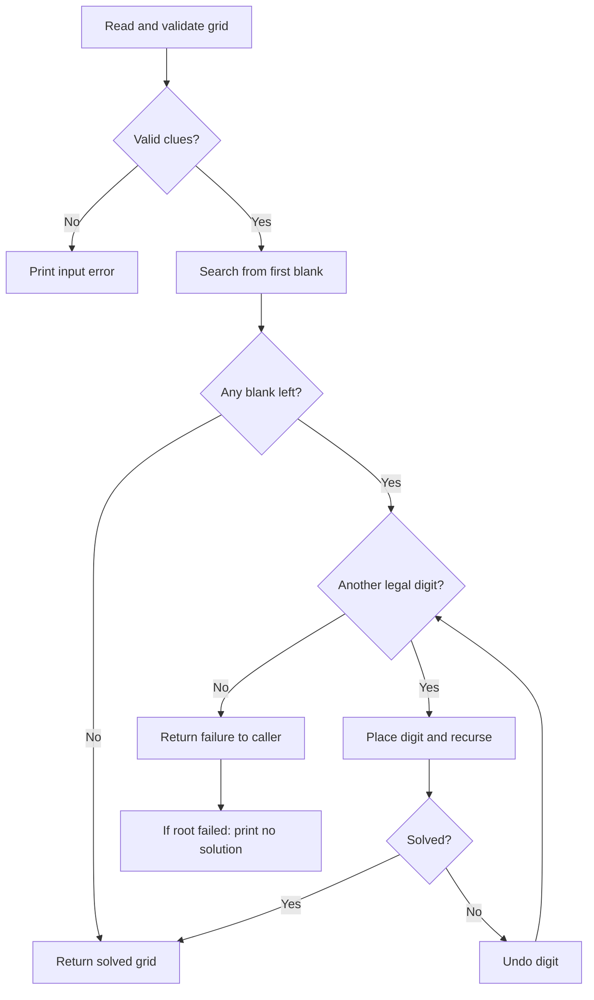

# Sudoku Solver

**Aim:** Complete a 9×9 grid using digits 1–9, without repetition in any row, column, or 3×3 box.

```sh
python3 sudoku/main.py
```

Enter nine space-separated rows; **0 means blank**. Example:

```text
5 3 0 0 7 0 0 0 0
6 0 0 1 9 5 0 0 0
0 9 8 0 0 0 0 6 0
8 0 0 0 6 0 0 0 3
4 0 0 8 0 3 0 0 1
7 0 0 0 2 0 0 0 6
0 6 0 0 0 0 2 8 0
0 0 0 4 1 9 0 0 5
0 0 0 0 8 0 0 7 9
```

**Result:** Prints `Solution:` followed by the completed grid shown below. Dark digits are original clues; blue digits fill the blanks.



## Algorithm

Validate size, digit range, and clues. Choose the first blank cell, try legal digits 1–9, and recurse. Undo a choice when it leads to a dead end. Stop at the first solution.



For blank $(r,c)$, candidates are

$$\{1,\ldots,9\}\setminus\bigl(R_r\cup C_c\cup B_{\lfloor r/3\rfloor,\lfloor c/3\rfloor}\bigr).$$

**Performance:** For $E$ blanks, at most $9^E$ search branches; time $O(9^E)$ for the fixed 9×9 board, extra space $O(E+81)$ including recursion and a board copy. Difficult puzzles can be slow. Existing clues stay unchanged; uniqueness is not checked.

**Learning:** Backtracking, pruning invalid candidates, and validating constraints before search.
