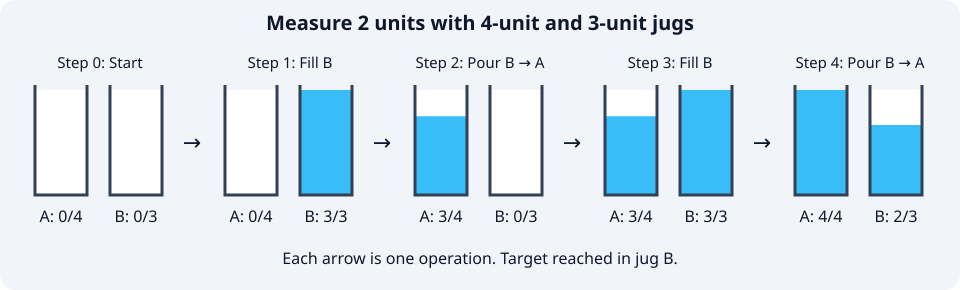
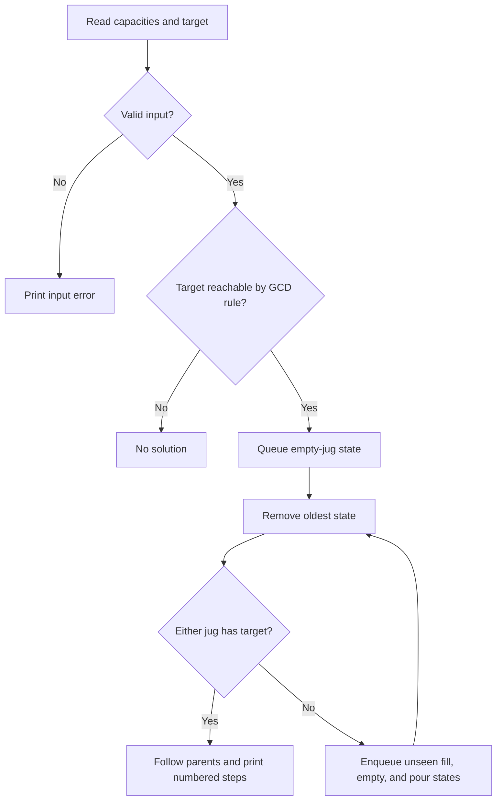

# Water Jug

**Aim:** Measure a target amount in either jug using fill, empty, and pour operations. Supply and drain are unlimited; amounts are whole numbers.

```sh
python3 water_jug/main.py
```

Enter A = **4**, B = **3**, target = **2**:

```text
Step 0: Start | A = 0, B = 0
Step 1: Fill B | A = 0, B = 3
Step 2: Pour B -> A | A = 3, B = 0
Step 3: Fill B | A = 3, B = 3
Step 4: Pour B -> A | A = 4, B = 2
Answer: 2 in a jug. Total moves: 4
```



## Algorithm

Breadth-first search (BFS) visits each state `(a, b)` once. Parent links recover the shortest sequence.



For capacities $A,B>0$, a target $T\geq0$ is reachable iff

$$T\leq\max(A,B)\quad\text{and}\quad\gcd(A,B)\mid T.$$

Pour A → B: $p=\min(a,B-b)$, then $(a,b)\to(a-p,b+p)$.

**Performance:** At most $(A+1)(B+1)$ integer states; time and space $O(AB)$. BFS guarantees minimum moves because each action costs one move.

**Learning:** State modeling, visited sets, shortest paths, and parent-based path recovery.
